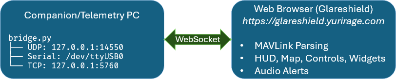

# Browser & Network Connection Guide

This guide explains how to connect Glareshield to your telemetry bridge (`bridge/bridge.py`), covering browser security policies, mixed-content restrictions, and secure `wss://` configuration.

---

## Quick Start

To explore the features of Glareshield, start a SITL session in Mission Planner or connect it to a live vehicle (Mission Planner automatically opens a WebSocket server on port 56781). On the same computer, open [Glareshield](https://glareshield.yurirage.com) in any modern web browser, click the connection pill in the upper right corner (or **Settings**) to open the **Link** tab, enter `ws://localhost:56781` as the address, and click **Connect**.

> [!NOTE]
> **Chrome Local Network Access**:
> When connecting to `ws://localhost:56781` from a public HTTPS page like `https://glareshield.yurirage.com`, modern Chromium browsers may display a permission prompt: *"Allow Glareshield to connect to devices on your local network?"*. Click **Allow** to permit the connection.

Alternatively, if you are not using Mission Planner, you can start the included companion bridge (`python3 bridge/bridge.py --udp 0.0.0.0:14550` to listen for vehicle broadcasts, `127.0.0.1:14550` for local SITL, or `--mock` for offline simulation).

To use Glareshield on other devices within the same local network (connecting to a LAN IP instead of localhost), continue reading below.

---

## Architecture



When you host Glareshield over **HTTPS** (e.g. [https://glareshield.yurirage.com](https://glareshield.yurirage.com)) and connect to a telemetry bridge on your local network (e.g. `ws://192.168.1.69:56781`), two browser security safeguards apply:

1. **Mixed Active Content**: Browsers prohibit secure HTTPS pages from opening unencrypted WebSockets (`ws://`) to protect users against man-in-the-middle attacks.
2. **Private Network Access (PNA)**: Chromium browsers restrict public web origins from initiating connections to private RFC 1918 IP addresses (`10.x.x.x`, `192.168.x.x`, `172.16-31.x.x`).

Additionally, `bridge.py` enforces an origin check during the WebSocket handshake to protect your vehicle from cross-site hijacking, and, when it has one, a **pairing token** that every device must present. The Docker bridge has a token by default: see [Pairing Devices](#pairing-devices-the-bridge-token).

Choose the setup that best fits your environment below.

---

## Option 1: Native TLS / `wss://` (Recommended for Encrypted Connections)

Configuring encrypted WebSockets (`wss://`) provides an encrypted telemetry transport. Note that when using self-signed certificates, client devices must perform a one-time trust/acceptance step.

### Method A: Automated Setup with Docker Compose

Running the bridge in Docker automates TLS certificate generation and host LAN IP detection.

> [!NOTE]
> **Zero-Configuration Scope**:
> Docker Compose provides an out-of-the-box **zero-configuration** experience when connecting to telemetry via standard **UDP broadcast** (`0.0.0.0:14550`), which is used by ArduPilot/PX4 SITL and most network telemetry radios. If you need to connect over **TCP** or **USB Serial**, a quick edit to `docker-compose.yml` is required as shown below.

#### 1. Download `docker-compose.yml`

You do not need to clone the entire repository to run the bridge. Create a dedicated directory on your bridge machine, download `docker-compose.yml`, and ensure you run all `docker compose` commands from within that directory (so Docker can locate the compose file and manage the `./certs` volume):

```bash
mkdir -p glareshield-bridge && cd glareshield-bridge
curl -O https://raw.githubusercontent.com/yuri-rage/mavlink-glareshield/master/docker-compose.yml
```

#### 2. Configure Telemetry Transport (If Not Using Default UDP Broadcast)

If your setup matches the default UDP broadcast on port 14550, you can skip this step. Otherwise, open `docker-compose.yml` in an editor:

- **TCP Telemetry** (e.g. companion computer, SITL TCP, or wireless router):
  ```yaml
  environment:
    - MODE=tcp
    - TARGET=192.168.1.50:5760   # Replace with vehicle/router IP and port
    - AUTO_TLS=true
  ```

- **Serial Telemetry** (e.g. SiK telemetry radio, USB FTDI, or Pixhawk USB):
  1. Set `MODE=serial` and specify the device path and baud rate in `TARGET`:
     ```yaml
     environment:
       - MODE=serial
       - TARGET=/dev/ttyUSB0:57600  # or /dev/ttyACM0:115200
       - AUTO_TLS=true
     ```
  2. Map the physical USB device into the container by uncommenting the `devices:` block:
     ```yaml
     devices:
       - /dev/ttyUSB0:/dev/ttyUSB0
     ```
  > [!TIP]
  > The container startup script automatically detects the host GID of your serial device (matching Debian/Ubuntu `dialout` GID 20, Fedora GID 18, Arch `uucp` GID 14, etc.) and grants proper permissions before dropping to the unprivileged `glareshield` user.

#### 3. Start the Container

From within the directory containing `docker-compose.yml`:

```bash
docker compose up -d
```

#### 4. Check Bridge Logs

```bash
docker compose logs
```

The container automatically detects your host's network interfaces and hostname via the kernel, generates a 2048-bit RSA TLS certificate with all IP/DNS Subject Alternative Names (`subjectAltName`) into `./certs/`, creates a pairing token (kept in `./certs/token`), and prints your connection details and a **pairing QR code**:
```text
============================================================
 MAVLink Glareshield Bridge Container
 Mode:       udp (0.0.0.0:14550)
 Protocol:   wss://0.0.0.0:56781
 TLS Active: true
 Connect at: wss://192.168.1.69:56781/
 Token:      new, saved in /certs/token (delete it and restart to change it)
             Pair each device with the QR code below (or the link under it).
============================================================
------------------------------------------------------------
 Pair a device: scan this QR code, or open the link below.
 ▄▄▄▄▄▄▄ ▄ ▄▄  ▄▄▄▄▄▄▄
 █ ▄▄▄ █ ▀█▄█▀ █ ▄▄▄ █     (the QR code)
 ...
 (also saved as /certs/pair.svg)
 https://192.168.1.69:56781/pair?token=nzZwtJNtd2u8lZSFFGoDRQ
 Or in Glareshield's Link settings: wss://192.168.1.69:56781/?token=nzZwtJNtd2u8lZSFFGoDRQ
------------------------------------------------------------
```

#### 5. Pair Each Device

Scan the QR code with each phone or tablet's camera (or open the link under it on a laptop). The scan also takes care of the self-signed certificate: accept the browser's warning once, and Glareshield opens and asks to connect to the bridge. Step by step, and the other ways to pair, in [Pairing Devices](#pairing-devices-the-bridge-token).

> [!NOTE]
> **Docker Desktop & Field Networks**:
> - If running Docker Desktop (macOS/Windows) where containers use internal bridge networking, set `CERT_CN=<your-lan-ip>` in `docker-compose.yml` so the certificate includes the host's LAN IP rather than the Docker internal IP.
> - Any existing certificates placed in `./certs` (e.g. from Let's Encrypt or nginx) are preserved and will **never** be overwritten. If your IP address changes or you need to re-issue an expired self-signed certificate, delete `./certs` (`rm -rf certs/*`) and restart the container to regenerate.

### Method B: Manual Python & OpenSSL Setup

#### 1. Generate SSL Certificates on your Bridge Machine

Run this command on the machine running `bridge.py` (replace `192.168.1.69` with your machine's IP or hostname):

```bash
openssl req -x509 -newkey rsa:2048 -nodes \
  -keyout key.pem -out cert.pem -days 365 \
  -subj "/CN=192.168.1.69" \
  -addext "subjectAltName=IP:192.168.1.69,DNS:localhost,IP:127.0.0.1"
```

#### 2. Start the Bridge with TLS

Pass `--ssl-cert` and `--ssl-key` to `bridge.py`:

```bash
# Example with UDP (listening for any vehicle or SITL broadcast):
python3 bridge/bridge.py --host 0.0.0.0 --port 56781 --udp 0.0.0.0:14550 \
  --ssl-cert cert.pem --ssl-key key.pem

# Example with physical telemetry radio (Serial):
python3 bridge/bridge.py --host 0.0.0.0 --port 56781 --serial /dev/ttyUSB0:57600 \
  --ssl-cert cert.pem --ssl-key key.pem
```

The console will confirm:
```
============================================================
 MAVLink Glareshield Bridge running on wss://0.0.0.0:56781
============================================================
```

> [!IMPORTANT]
> With `--host 0.0.0.0` the bridge is reachable from your whole network. Give it a pairing token so only your devices can connect (the Docker bridge does this for you):
> ```bash
> export BRIDGE_TOKEN="$(python3 -c 'import secrets; print(secrets.token_urlsafe(16))')"
> python3 bridge/bridge.py --host 0.0.0.0 --port 56781 --udp 0.0.0.0:14550 \
>   --ssl-cert cert.pem --ssl-key key.pem --pair-host 192.168.1.69
> ```
> It prints a pairing QR code (`pip install segno` for the QR; the link is printed either way). See [Pairing Devices](#pairing-devices-the-bridge-token).

### Trusting the Self-Signed Certificate on Clients (First Time Only)

Whether generated automatically via Docker Compose (Method A) or manually with OpenSSL (Method B), self-signed certificates are not signed by a recognized Certificate Authority (CA). Modern browsers and mobile operating systems silently abort background WebSocket connections to self-signed endpoints until you authorize the certificate in a browser tab:

1. Open a new tab in your browser (on desktop or mobile) and navigate directly to:
   ```text
   https://192.168.1.69:56781
   ```
2. Proceed past the certificate warning:
   - **Chrome**: Click **Advanced → Proceed to 192.168.1.69**.
   - **Firefox**: Click **Advanced → Accept the Risk and Continue**.
   - **Safari (iOS / iPadOS / macOS)**: Tap **Show Details → visit this website** (and confirm when prompted).
   > [!NOTE]
   > The bridge answers with a short page: *"Glareshield bridge: this browser now trusts its certificate. You can close this tab."* (An older bridge shows `Failed to open a WebSocket connection: missing Connection header`, which means the same thing.)
3. Close the tab, open [https://glareshield.yurirage.com](https://glareshield.yurirage.com), and in **Settings → Link** connect to the bridge's link, with its pairing token if it has one:
   ```text
   wss://192.168.1.69:56781/?token=<token>
   ```

> [!TIP]
> With a pairing token you rarely need these steps: scanning the bridge's pairing QR code opens the bridge's `/pair` page, which is this certificate step, and then opens Glareshield connected. See [Pairing Devices](#pairing-devices-the-bridge-token).

---

## Pairing Devices (the Bridge Token)

Anything on your network that can reach the bridge's port could otherwise connect to it and command the vehicle: arm it, change its mode, write parameters. The browser `Origin` check stops other websites from doing that, but it isn't a password: a script or app that isn't a browser sends no Origin at all. So the bridge can require a **pairing token**: a secret that every device presents in its link, `wss://192.168.1.69:56781/?token=<token>`. Without it the bridge closes the connection before sending or relaying anything.

- **The Docker bridge has a token by default.** It is created on first start and kept in `./certs/token`.
- **`bridge.py` run by hand has none** unless you give it one (`--token`, or the `BRIDGE_TOKEN` environment variable). It listens only on `127.0.0.1` by default, where a token isn't needed. Give it one whenever you use `--host 0.0.0.0`.
- **Mission Planner's** WebSocket (port 56781 on the Mission Planner computer) is its own server and has no token.

### Creating the Token

Set `TOKEN` in `docker-compose.yml`:

| `TOKEN` | What happens |
| :--- | :--- |
| *(empty, the default)* | A random token (22 characters) is generated on first start and saved in `./certs/token`. Later starts reuse it, so devices stay paired across restarts and image updates. |
| `TOKEN=<passphrase>` | Your own token. Handy when you set up a headless bridge from a phone and would rather type something you know. Use 12 characters or more: the bridge warns about anything shorter, since anyone on your network could guess it. Letters, digits, `-` and `_` are the easiest to type into a link. |
| `TOKEN=off` | No token: anyone who can reach port 56781 can connect and command the vehicle. Only for a network that nothing else can join. |

After changing `TOKEN`, run `docker compose up -d` again.

**Reading the token** on the bridge machine: `cat certs/token` (in the folder holding `docker-compose.yml`), or `docker compose logs` (the startup lines show it in the pairing link). `./certs/token`, `./certs/key.pem` and `./certs/pair.svg` are readable only by the owner of the `certs` folder, which is normally you.

**Changing the token** (a lost phone, a token you shared by mistake): delete `certs/token` and run `docker compose restart`. A new token is generated, and every device has to pair again. Devices with the old token see *"Wrong pairing token for this bridge"*.

**Without Docker**, generate one and pass it in the environment (the command line would show it to every process on the machine):
```bash
export BRIDGE_TOKEN="$(python3 -c 'import secrets; print(secrets.token_urlsafe(16))')"
echo "$BRIDGE_TOKEN"   # keep it somewhere safe, or reuse it next time
python3 bridge/bridge.py --host 0.0.0.0 --udp 0.0.0.0:14550 --ssl-cert cert.pem --ssl-key key.pem \
  --pair-host 192.168.1.69 --pair-svg pair.svg
```
`--pair-host` is the address your devices reach the bridge at (the bridge guesses its LAN address otherwise); `--pair-svg` also saves the QR code as an image.

### Pairing a Phone or Tablet

1. On the bridge machine, run `docker compose logs` and find the **QR code** (it is drawn black on white, so it scans from a dark or light terminal).
2. Point the phone's camera at it and open the link it shows.
3. **With TLS** (the Docker default): the browser warns about the bridge's self-signed certificate. Accept it once: Chrome **Advanced → Proceed**, Safari **Show Details → visit this website**, Firefox **Advanced → Accept the Risk and Continue**. This is the one-time [certificate step](#trusting-the-self-signed-certificate-on-clients-first-time-only); the bridge then checks the token and sends the phone on to Glareshield. **Without TLS**, the QR opens Glareshield directly.
4. Glareshield asks **Connect to this bridge?**, naming the bridge's address (and the link it replaces, if any). Tap **Connect**.

The phone is paired: Glareshield keeps the link, token included, in that browser. The token never reaches Glareshield's web server: it travels in the part of the link after `#`, which browsers don't send, and Glareshield removes it from the address bar as soon as the page opens.

### Other Ways to Pair

- **A laptop or desktop**: open the link printed under the QR code, or paste the *"Or in Glareshield's Link settings"* link into **Settings → Link** and click **Connect**. Over `wss://`, open `https://<bridge-ip>:56781` once first to accept the certificate.
- **From a device that is already paired**: **Settings → Link → Pair another device…** shows a QR code of the same link the bridge's QR code holds: scan it with the other device's camera. Or **Copy** or **Share** the link, send it to yourself (it carries the token), and open it on the other device. No terminal needed.
- **The QR code as an image**: `./certs/pair.svg`, to open on another screen or print. Keep it to yourself: it holds the token. Without access to the bridge machine's files: `docker compose cp bridge:/certs/pair.svg .`
- **A headless bridge set up from a phone**: set `TOKEN=<passphrase>` in `docker-compose.yml`, open `https://<bridge-ip>:56781` on the phone to accept the certificate, then enter `wss://<bridge-ip>:56781/?token=<passphrase>` in **Settings → Link**.

### Upgrading from a Bridge without a Token

The first start of a bridge image with tokens creates one, and devices that connected before can no longer connect until they pair. Glareshield says *"This bridge needs a pairing token"* and stops retrying. Pair each device once as above. To keep the old behavior instead, set `TOKEN=off` (not recommended).

### What the Token Does and Doesn't Do

- It keeps out other devices and apps on your network, and web pages served from them, which the Origin check alone let through.
- Over plain `ws://`, the token crosses the network unencrypted, where anyone who can watch your Wi-Fi traffic could read it. Keep TLS on (`AUTO_TLS=true`, the default in `docker-compose.yml`) or use a [reverse proxy](reverse-proxy.md) with a trusted certificate.
- It is not enough on its own for a bridge reachable from the internet: see [Option 4](#option-4-local-reverse-proxy--cloudflare-tunnel--caddy).
- Only paired devices can use the bridge's NTRIP relay. The relay only opens connections to NTRIP caster ports (2101–2105), including casters on your own network.

### Pairing Messages

| Where | Message | What to do |
| :--- | :--- | :--- |
| Glareshield (Settings → Link) | *This bridge needs a pairing token* | This device isn't paired: scan the bridge's QR code, or add `?token=<token>` to the link. |
| Glareshield (Settings → Link) | *Wrong pairing token for this bridge* | The token changed (or was mistyped): pair again from the QR code. |
| Browser, after scanning | *Wrong or missing pairing token* (403) | The QR code is from before the token changed: run `docker compose logs` and scan the new one. |
| Browser, after scanning | *Pairing is off* (404) | The bridge has no token (`TOKEN=off`, or `bridge.py` without `--token`): connect with its plain link. |
| Phone camera | The QR code won't scan | Zoom out until the whole code fits, or widen the terminal (it needs about 50 columns). Or open `./certs/pair.svg`, or use the link under the code. |
| Glareshield, after scanning | Connects to the wrong address (e.g. `172.17.0.2`) | The bridge guessed the wrong address for the QR code, which happens with Docker Desktop. Set `CERT_CN=<bridge-lan-ip>` in `docker-compose.yml` (it also fixes the certificate) and restart. |
| Bridge log | `[SECURITY] Closed WebSocket from ...: pairing token required` | A device without the token tried to connect. If it isn't yours, something on your network is probing the bridge. |

---

## Option 2: Firefox Configuration (Connecting to a Remote LAN IP)

`localhost` connections work out-of-the-box in Firefox. However, if you are connecting across your local network to another computer's LAN IP (e.g. `ws://192.168.1.69:56781`), you can allow unencrypted WebSockets from HTTPS without needing SSL certificates:

> [!WARNING]
> Toggling `network.websocket.allowInsecureFromHTTPS` is a global Firefox preference that applies to all HTTPS websites visited in that browser profile.

1. In Firefox, open a new tab to:
   ```text
   about:config
   ```
2. Click **Accept the Risk and Continue**.
3. Search for:
   ```text
   network.websocket.allowInsecureFromHTTPS
   ```
4. Double-click to toggle the value to **`true`**.
5. Reload [https://glareshield.yurirage.com](https://glareshield.yurirage.com).
6. Open **Settings → Link** (the gear icon) and connect to:
   ```text
   ws://192.168.1.69:56781/
   ```

---

## Option 3: Chrome / Chromium Browser Configuration

Chromium-based browsers (Google Chrome, Microsoft Edge, Brave, Opera) require permitting insecure content for the specific site, and may require allowing private network access.

### Step 1: Allow Insecure Content (Per-Site)

1. Open [https://glareshield.yurirage.com](https://glareshield.yurirage.com).
2. Click the **tune / site information icon** (or padlock) immediately to the left of `https://` in the address bar.
3. Select **Site settings**.
4. Scroll down to **Insecure content** (default is *Block*).
5. Change the setting to **Allow**.
6. Switch back to your Glareshield tab and click **Reload**.

### Step 2: Local Network Access (Internet Origin → Local IP)

When a public web origin (such as `glareshield.yurirage.com`) connects to a local RFC 1918 IP address (`10.x.x.x`, `192.168.x.x`, `172.16-31.x.x`), Chrome's **Local Network Access (LNA)** policy applies.

Modern Chromium browsers will display a prompt: *"Allow Glareshield to connect to devices on your local network?"*. Click **Allow**.

If Chrome blocks local network requests or you need to inspect the policy:
1. In Chrome, open:
   ```text
   chrome://flags/#local-network-access-check
   chrome://flags/#local-network-access-check-websockets
   ```
2. Verify that Local Network Access checks are set to their default prompt behavior, or disable them temporarily for testing.

### Dedicated Desktop Launcher (Field Laptop Alternative)

You can launch a dedicated Chrome instance with mixed-content checks disabled for field use:

```bash
google-chrome \
  --allow-running-insecure-content \
  --unsafely-treat-insecure-origin-as-secure="ws://192.168.1.69:56781" \
  https://glareshield.yurirage.com
```

---

## Option 4: Local Reverse Proxy / Cloudflare Tunnel / Caddy

For an automated setup that handles real public certificates (e.g. Let's Encrypt or Cloudflare Zero Trust) with zero browser trust configuration required:

📖 **For a complete walkthrough with Nginx Proxy Manager, a Let's Encrypt wildcard certificate and Pi-hole local DNS, see the [Reverse Proxy Setup guide](reverse-proxy.md).**

> [!CAUTION]
> **CRITICAL SECURITY WARNING: NEVER EXPOSE AN UNAUTHENTICATED BRIDGE TO THE OPEN INTERNET**
> 
> Anyone who connects to your WebSocket endpoint can issue vehicle commands, trigger motors/actuators, arm/disarm, and alter flight parameters.
> 
> The browser `Origin` check guards against cross-site web scripts, but direct CLI tools and non-browser clients send no Origin header. The [pairing token](#pairing-devices-the-bridge-token) keeps out anyone without it, but it is a single shared secret, which a proxy may record in its access logs (it travels in the link's query string), and it has no rate limit on guesses.
> 
> If you make your bridge reachable outside your local network, keep the token **and** protect it with an authentication gateway:
> - **Cloudflare Zero Trust (Access)**: Put a Cloudflare Access policy (email OTP, Google/GitHub OAuth) in front of your tunnel hostname.
> - **Private Mesh VPN (Recommended)**: Use [Tailscale](https://tailscale.com) or WireGuard so only your authorized devices can reach the bridge machine's IP.
> - **Authenticated Reverse Proxy**: Because browsers cannot reliably send HTTP Basic Auth credentials during native WebSocket handshakes, protect your reverse proxy with an IP allowlist, a query-string authentication token, mutual TLS (client certificates), or an identity proxy.

### Caddy (Automatic HTTPS on Local Network)

Create a `Caddyfile`:

```caddy
gcs-bridge.your-domain.com {
    reverse_proxy 127.0.0.1:56781
}
```

Run `caddy run`. Connect in Glareshield to `wss://gcs-bridge.your-domain.com`.

### Cloudflare Tunnel (`cloudflared`) with Access

For remote internet access, use a **Named Cloudflare Tunnel** protected by **Cloudflare Access**:

1. Create a named tunnel in your Cloudflare dashboard (or CLI: `cloudflared tunnel create glareshield-bridge`).
2. Route a public hostname (e.g. `telemetry.yourdomain.com`) to `ws://localhost:56781`.
3. In **Cloudflare Zero Trust → Access → Applications**, add an application covering `telemetry.yourdomain.com` requiring email PIN or OAuth authentication.
4. Run the tunnel:
   ```bash
   cloudflared tunnel run glareshield-bridge
   ```
   *(Note: `cloudflared tunnel --url` creates an unauthenticated, ephemeral quick-tunnel on `trycloudflare.com`, which should never be used for live vehicle control).*

---

## Option 5: Direct USB Serial (No Bridge)

Chromium browsers can open a USB serial device themselves, so a telemetry radio or a flight controller's USB port can connect to Glareshield with no bridge, no certificates, and no mixed-content restrictions (the link never leaves the browser).

1. Plug in the telemetry radio or flight controller.
2. Open **Settings → Link**, choose **Link type → USB serial**, and pick a baud rate (SiK radios usually use `57600`; a flight controller's own USB port ignores it).
3. Click **Connect** and choose the device in the browser's prompt.

Glareshield remembers the device: automatic reconnects after a cable blip, and later page loads, reopen it without asking again. To use a different device, disconnect, click **Connect** again and pick it.

| Browser | How serial works | What it reaches |
|---|---|---|
| Chrome / Edge (desktop) | Web Serial | Any USB serial adapter: SiK radios (FTDI, CP210x), flight controller USB |
| Chrome (Android) | WebUSB | A flight controller's own USB port (USB CDC-ACM) only; FTDI/CP210x radios are not supported |
| Firefox, Safari, iOS | Not available | Use the bridge over WebSocket |

Limitations:
- **NTRIP via the bridge** needs the bridge's WebSocket side channel, so it is not available on a serial link. A USB RTK base station (RTK widget → serial) still works alongside a serial telemetry link.
- One program at a time can own a serial port. Close Mission Planner (or any other app or tab) that has the port open first.
- On Android, some devices ship a driver that permanently claims the board's USB interface; there is no way around that from a web page, so use the bridge there.

---

## Several Vehicles on One Link

Glareshield lists every autopilot it hears on the link and commands one at a time (a **SYS n / N** chip appears in the navbar; the others show on the map). See [Several vehicles on one link](user-guide.md#several-vehicles-on-one-link) for switching.

- **Give each vehicle its own system ID** (`MAV_SYSID` on current ArduPilot, `SYSID_THISMAV` on older releases). Vehicles sharing an ID can't be told apart.
- **UDP**: in UDP mode the bridge serves several vehicle endpoints at once, so point every vehicle (or SITL instance) at the bridge's UDP port, e.g. `--serial0 udpclient:<bridge-ip>:14550` for SITL.
- **One radio, several aircraft**: anything that merges their MAVLink streams onto one link (MAVProxy, a mesh radio network) works the same way.
- The commanded vehicle gets the telemetry rates Glareshield asks for; the others' positions are only as frequent as their own stream settings send them.

---

## Bridge Security & Origin Configuration

[`bridge/bridge.py`](../bridge/bridge.py) guards against Cross-Site WebSocket Hijacking by inspecting the `Origin` header during the initial HTTP handshake. The Origin check keeps out other websites; it isn't authentication. That is the [pairing token](#pairing-devices-the-bridge-token)'s job, and both apply when the bridge has a token.

### Built-in Allowed Origins

By default, the bridge permits connections from:
- `http://localhost:*` and `http://127.0.0.1:*`
- Private network IPs: `192.168.*`, `10.*`, `172.16-31.*`
- Production domain: `https://glareshield.yurirage.com`
- `tauri://*` (desktop companion)
- Direct CLI tools and scripts without an Origin header (`None`). With a pairing token they still need the token.

### Custom Domains

If hosting Glareshield on a custom domain, pass `--allow-origin` when starting the bridge:

```bash
# Allow a specific custom origin:
python3 bridge/bridge.py --udp 0.0.0.0:14550 --allow-origin "https://gcs.example.com"

# Allow all origins (field/testing only):
python3 bridge/bridge.py --udp 0.0.0.0:14550 --allow-all-origins
```

If an unauthorized origin attempts to connect, the bridge prints:
```text
[SECURITY] Refused WebSocket connection from Origin: https://unauthorized-site.com
           To permit this, restart bridge with: --allow-origin "https://unauthorized-site.com" or --allow-all-origins
```

---

## Troubleshooting Checklist

| Symptom | Cause | Solution |
| :--- | :--- | :--- |
| **"The connection to ws://... was interrupted while the page was loading"** | Browser Mixed Content policy blocking `ws://` from an `https://` site. | See [Option 1](#option-1-native-tls--wss-recommended-for-encrypted-connections) for `wss://` or [Option 2 / 3](#option-2-firefox-configuration-connecting-to-a-remote-lan-ip) for browser overrides. |
| **Bridge console shows `Refused WebSocket connection from Origin`** | Host domain not in bridge allowlist. | Pass `--allow-origin "https://yourdomain.com"` or `--allow-all-origins` to `bridge.py`. |
| **Bridge connected, but 0 pkts/s and no telemetry received over UDP** | Host firewall blocking inbound UDP port 14550. | On Linux/NixOS, ensure port 14550/udp is allowed in your firewall (e.g. `sudo iptables -I INPUT -p udp --dport 14550 -j ACCEPT` or `sudo ufw allow 14550/udp`). |
| **"WebSocket connection failed" / Connection timed out** | Bridge is only bound to `127.0.0.1`. | Restart the bridge with `--host 0.0.0.0` so it listens on all network interfaces. |
| **"This bridge needs a pairing token"** or **"Wrong pairing token for this bridge"** | The device isn't paired, or the bridge's token changed. | Pair it: see [Pairing Devices](#pairing-devices-the-bridge-token). |
| **The bridge container stops at once, log shows `Could not bind to 0.0.0.0:14550`** | Another program (often Mission Planner) holds UDP port 14550. | Close it, or forward MAVLink to another port as the log explains. The bridge stops instead of running without a vehicle link. |
| **Container log: `CERT_CN='...' is not a hostname or IP address`** | `CERT_CN` contains characters a certificate name can't have. | Set it to the bridge's LAN IP (e.g. `192.168.1.69`) or hostname. |
| **"An AudioContext was prevented from starting automatically"** | Browser autoplay policy requiring gesture. | Click or tap anywhere in the application window to unlock audio callouts. |
