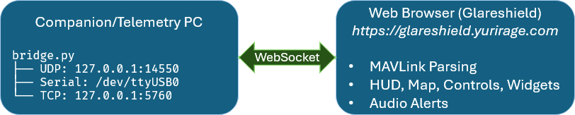

# Browser & Network Connection Guide

This guide explains how to connect Glareshield to your telemetry bridge (`bridge/bridge.py`), covering browser security policies, mixed-content restrictions, and secure `wss://` configuration.

---

## Quick Start

To explore the features of Glareshield, start a SITL session in Mission Planner or connect it to a live vehicle (Mission Planner automatically opens a WebSocket server on port 56781). On the same computer, open [Glareshield](https://glareshield.yurirage.com) in any modern web browser, click "Connect" in the upper right corner, enter `ws://localhost:56781` as the host:port, and click "Connect Now."

> [!NOTE]
> **Chrome Local Network Access**:
> When connecting to `ws://localhost:56781` from a public HTTPS page like `https://glareshield.yurirage.com`, modern Chromium browsers may display a permission prompt: *"Allow Glareshield to connect to devices on your local network?"*. Click **Allow** to permit the connection.

Alternatively, if you are not using Mission Planner, you can start the included companion bridge (`python3 bridge/bridge.py --udp 0.0.0.0:14550` to listen for vehicle broadcasts, `127.0.0.1:14550` for local SITL, or `--mock` for offline simulation).

To use Glareshield on other devices within the same local network (connecting to a LAN IP instead of localhost), continue reading below.

---

## Architecture



When you host Glareshield over **HTTPS** (e.g. [https://glareshield.yurirage.com](https://glareshield.yurirage.com)) and connect to a telemetry bridge on your local network (e.g. `ws://192.168.1.69:56781`), two browser security safeguards apply:

1. **Mixed Active Content**: Browsers prohibit secure HTTPS pages from opening unencrypted WebSockets (`ws://`) to protect users against man-in-the-middle attacks.
2. **Private Network Access (PNA)**: Chromium browsers restrict public web origins from initiating connections to private RFC 1918 IP addresses (`10.x.x.x`, `192.168.x.x`, `172.16-31.x.x`).

Additionally, `bridge.py` enforces an origin check during the WebSocket handshake to protect your vehicle from cross-site hijacking.

Choose the setup that best fits your environment below.

---

## Option 1: Native TLS / `wss://` (Recommended for Encrypted Connections)

Configuring encrypted WebSockets (`wss://`) provides an encrypted telemetry transport. Note that when using self-signed certificates, client devices must perform a one-time trust/acceptance step.

### Method A: Automated Setup with Docker Compose

Running the bridge in Docker automates TLS certificate generation and host LAN IP detection.

> [!NOTE]
> **Zero-Configuration Scope**:
> Docker Compose provides an out-of-the-box **zero-configuration** experience when connecting to telemetry via standard **UDP broadcast** (`0.0.0.0:14550`), which is used by ArduPilot/PX4 SITL and most network telemetry radios. If you need to connect over **TCP** or **USB Serial**, a quick edit to `docker-compose.yml` is required as shown below.

#### 1. Download `docker-compose.yml`

You do not need to clone the entire repository to run the bridge. Create a dedicated directory on your bridge machine, download `docker-compose.yml`, and ensure you run all `docker compose` commands from within that directory (so Docker can locate the compose file and manage the `./certs` volume):

```bash
mkdir -p glareshield-bridge && cd glareshield-bridge
curl -O https://raw.githubusercontent.com/yuri-rage/mavlink-glareshield/master/docker-compose.yml
```

#### 2. Configure Telemetry Transport (If Not Using Default UDP Broadcast)

If your setup matches the default UDP broadcast on port 14550, you can skip this step. Otherwise, open `docker-compose.yml` in an editor:

- **TCP Telemetry** (e.g. companion computer, SITL TCP, or wireless router):
  ```yaml
  environment:
    - MODE=tcp
    - TARGET=192.168.1.50:5760   # Replace with vehicle/router IP and port
    - AUTO_TLS=true
  ```

- **Serial Telemetry** (e.g. SiK telemetry radio, USB FTDI, or Pixhawk USB):
  1. Set `MODE=serial` and specify the device path and baud rate in `TARGET`:
     ```yaml
     environment:
       - MODE=serial
       - TARGET=/dev/ttyUSB0:57600  # or /dev/ttyACM0:115200
       - AUTO_TLS=true
     ```
  2. Map the physical USB device into the container by uncommenting the `devices:` block:
     ```yaml
     devices:
       - /dev/ttyUSB0:/dev/ttyUSB0
     ```
  > [!TIP]
  > The container startup script automatically detects the host GID of your serial device (matching Debian/Ubuntu `dialout` GID 20, Fedora GID 18, Arch `uucp` GID 14, etc.) and grants proper permissions before dropping to the unprivileged `glareshield` user.

#### 3. Start the Container

From within the directory containing `docker-compose.yml`:

```bash
docker compose up -d
```

#### 4. Check Bridge Logs

```bash
docker compose logs
```

The container automatically detects your host's network interfaces and hostname via the kernel, generates a 2048-bit RSA TLS certificate with all IP/DNS Subject Alternative Names (`subjectAltName`) into `./certs/`, and prints your direct connection URL:
```text
============================================================
 MAVLink Glareshield Bridge Container
 Mode:       udp (0.0.0.0:14550)
 Protocol:   wss://0.0.0.0:56781
 TLS Active: true
 Connect at: wss://192.168.1.69:56781/
============================================================
```

#### 5. Authorize the Certificate on Each Client Browser / Device

Before connecting in Glareshield over `wss://`, follow the one-time [Client Certificate Acceptance steps](#trusting-the-self-signed-certificate-on-clients-first-time-only) below to open `https://<ip>:56781` in a browser tab and accept the self-signed certificate.

> [!NOTE]
> **Docker Desktop & Field Networks**:
> - If running Docker Desktop (macOS/Windows) where containers use internal bridge networking, set `CERT_CN=<your-lan-ip>` in `docker-compose.yml` so the certificate includes the host's LAN IP rather than the Docker internal IP.
> - Any existing certificates placed in `./certs` (e.g. from Let's Encrypt or nginx) are preserved and will **never** be overwritten. If your IP address changes or you need to re-issue an expired self-signed certificate, delete `./certs` (`rm -rf certs/*`) and restart the container to regenerate.

### Method B: Manual Python & OpenSSL Setup

#### 1. Generate SSL Certificates on your Bridge Machine

Run this command on the machine running `bridge.py` (replace `192.168.1.69` with your machine's IP or hostname):

```bash
openssl req -x509 -newkey rsa:2048 -nodes \
  -keyout key.pem -out cert.pem -days 365 \
  -subj "/CN=192.168.1.69" \
  -addext "subjectAltName=IP:192.168.1.69,DNS:localhost,IP:127.0.0.1"
```

#### 2. Start the Bridge with TLS

Pass `--ssl-cert` and `--ssl-key` to `bridge.py`:

```bash
# Example with UDP (listening for any vehicle or SITL broadcast):
python3 bridge/bridge.py --host 0.0.0.0 --port 56781 --udp 0.0.0.0:14550 \
  --ssl-cert cert.pem --ssl-key key.pem

# Example with physical telemetry radio (Serial):
python3 bridge/bridge.py --host 0.0.0.0 --port 56781 --serial /dev/ttyUSB0:57600 \
  --ssl-cert cert.pem --ssl-key key.pem
```

The console will confirm:
```
============================================================
 MAVLink Glareshield Bridge running on wss://0.0.0.0:56781
============================================================
```

### Trusting the Self-Signed Certificate on Clients (First Time Only)

Whether generated automatically via Docker Compose (Method A) or manually with OpenSSL (Method B), self-signed certificates are not signed by a recognized Certificate Authority (CA). Modern browsers and mobile operating systems silently abort background WebSocket connections to self-signed endpoints until you authorize the certificate in a browser tab:

1. Open a new tab in your browser (on desktop or mobile) and navigate directly to:
   ```text
   https://192.168.1.69:56781
   ```
2. Proceed past the certificate warning:
   - **Chrome**: Click **Advanced → Proceed to 192.168.1.69**.
   - **Firefox**: Click **Advanced → Accept the Risk and Continue**.
   - **Safari (iOS / iPadOS / macOS)**: Tap **Show Details → visit this website** (and confirm when prompted).
   > [!NOTE]
   > The browser will display: `Failed to open a WebSocket connection: missing Connection header`. **This is expected and normal!** It confirms the browser completed the TLS handshake with the bridge before reaching the WebSocket endpoint.
3. Close the tab, open [https://glareshield.yurirage.com](https://glareshield.yurirage.com), and in **Link Settings** connect to:
   ```text
   wss://192.168.1.69:56781/
   ```

---

## Option 2: Firefox Configuration (Connecting to a Remote LAN IP)

`localhost` connections work out-of-the-box in Firefox. However, if you are connecting across your local network to another computer's LAN IP (e.g. `ws://192.168.1.69:56781`), you can allow unencrypted WebSockets from HTTPS without needing SSL certificates:

> [!WARNING]
> Toggling `network.websocket.allowInsecureFromHTTPS` is a global Firefox preference that applies to all HTTPS websites visited in that browser profile.

1. In Firefox, open a new tab to:
   ```text
   about:config
   ```
2. Click **Accept the Risk and Continue**.
3. Search for:
   ```text
   network.websocket.allowInsecureFromHTTPS
   ```
4. Double-click to toggle the value to **`true`**.
5. Reload [https://glareshield.yurirage.com](https://glareshield.yurirage.com).
6. Open **Link Settings** (gear icon) and connect to:
   ```text
   ws://192.168.1.69:56781/
   ```

---

## Option 3: Chrome / Chromium Browser Configuration

Chromium-based browsers (Google Chrome, Microsoft Edge, Brave, Opera) require permitting insecure content for the specific site, and may require allowing private network access.

### Step 1: Allow Insecure Content (Per-Site)

1. Open [https://glareshield.yurirage.com](https://glareshield.yurirage.com).
2. Click the **tune / site information icon** (or padlock) immediately to the left of `https://` in the address bar.
3. Select **Site settings**.
4. Scroll down to **Insecure content** (default is *Block*).
5. Change the setting to **Allow**.
6. Switch back to your Glareshield tab and click **Reload**.

### Step 2: Local Network Access (Internet Origin → Local IP)

When a public web origin (`glareshield.yurirage.com` or `glareshield.pages.dev`) connects to a local RFC 1918 IP address (`10.x.x.x`, `192.168.x.x`, `172.16-31.x.x`), Chrome's **Local Network Access (LNA)** policy applies.

Modern Chromium browsers will display a prompt: *"Allow Glareshield to connect to devices on your local network?"*. Click **Allow**.

If Chrome blocks local network requests or you need to inspect the policy:
1. In Chrome, open:
   ```text
   chrome://flags/#local-network-access-check
   chrome://flags/#local-network-access-check-websockets
   ```
2. Verify that Local Network Access checks are set to their default prompt behavior, or disable them temporarily for testing.

### Dedicated Desktop Launcher (Field Laptop Alternative)

You can launch a dedicated Chrome instance with mixed-content checks disabled for field use:

```bash
google-chrome \
  --allow-running-insecure-content \
  --unsafely-treat-insecure-origin-as-secure="ws://192.168.1.69:56781" \
  https://glareshield.yurirage.com
```

---

## Option 4: Local Reverse Proxy / Cloudflare Tunnel / Caddy

For an automated setup that handles real public certificates (e.g. Let's Encrypt or Cloudflare Zero Trust) with zero browser trust configuration required:

> [!CAUTION]
> **CRITICAL SECURITY WARNING: NEVER EXPOSE AN UNAUTHENTICATED BRIDGE TO THE OPEN INTERNET**
> 
> The MAVLink bridge protocol does not implement user authentication. Anyone who connects to your WebSocket endpoint can issue vehicle commands, trigger motors/actuators, arm/disarm, and alter flight parameters.
> 
> While the browser `Origin` check guards against cross-site web scripts, direct CLI tools and non-browser clients do not send an Origin header and are permitted by design.
> 
> If you make your bridge reachable outside your local network, you **MUST** protect it with an authentication gateway:
> - **Cloudflare Zero Trust (Access)**: Put a Cloudflare Access policy (email OTP, Google/GitHub OAuth) in front of your tunnel hostname.
> - **Private Mesh VPN (Recommended)**: Use [Tailscale](https://tailscale.com) or WireGuard so only your authorized devices can reach the bridge machine's IP.
> - **Authenticated Reverse Proxy**: Because browsers cannot reliably send HTTP Basic Auth credentials during native WebSocket handshakes, protect your reverse proxy with an IP allowlist, a query-string authentication token, mutual TLS (client certificates), or an identity proxy.

### Caddy (Automatic HTTPS on Local Network)

Create a `Caddyfile`:

```caddy
gcs-bridge.your-domain.com {
    reverse_proxy 127.0.0.1:56781
}
```

Run `caddy run`. Connect in Glareshield to `wss://gcs-bridge.your-domain.com`.

### Cloudflare Tunnel (`cloudflared`) with Access

For remote internet access, use a **Named Cloudflare Tunnel** protected by **Cloudflare Access**:

1. Create a named tunnel in your Cloudflare dashboard (or CLI: `cloudflared tunnel create glareshield-bridge`).
2. Route a public hostname (e.g. `telemetry.yourdomain.com`) to `ws://localhost:56781`.
3. In **Cloudflare Zero Trust → Access → Applications**, add an application covering `telemetry.yourdomain.com` requiring email PIN or OAuth authentication.
4. Run the tunnel:
   ```bash
   cloudflared tunnel run glareshield-bridge
   ```
   *(Note: `cloudflared tunnel --url` creates an unauthenticated, ephemeral quick-tunnel on `trycloudflare.com`, which should never be used for live vehicle control).*

---

## Bridge Security & Origin Configuration

[`bridge/bridge.py`](../bridge/bridge.py) guards against Cross-Site WebSocket Hijacking by inspecting the `Origin` header during the initial HTTP handshake.

### Built-in Allowed Origins

By default, the bridge permits connections from:
- `http://localhost:*` and `http://127.0.0.1:*`
- Private network IPs: `192.168.*`, `10.*`, `172.16-31.*`
- Production domain: `https://glareshield.yurirage.com`
- Cloudflare Pages project: `https://glareshield.pages.dev` and preview/branch URLs (`https://*.glareshield.pages.dev`)
- `tauri://*` (desktop companion)
- Direct CLI tools and scripts without an Origin header (`None`)

### Custom Domains

If hosting Glareshield on a custom domain, pass `--allow-origin` when starting the bridge:

```bash
# Allow a specific custom origin:
python3 bridge/bridge.py --udp 0.0.0.0:14550 --allow-origin "https://gcs.example.com"

# Allow all origins (field/testing only):
python3 bridge/bridge.py --udp 0.0.0.0:14550 --allow-all-origins
```

If an unauthorized origin attempts to connect, the bridge prints:
```text
[SECURITY] Refused WebSocket connection from Origin: https://unauthorized-site.com
           To permit this, restart bridge with: --allow-origin "https://unauthorized-site.com" or --allow-all-origins
```

---

## Troubleshooting Checklist

| Symptom | Cause | Solution |
| :--- | :--- | :--- |
| **"The connection to ws://... was interrupted while the page was loading"** | Browser Mixed Content policy blocking `ws://` from an `https://` site. | See [Option 1](#option-1-native-tls--wss-recommended-for-encrypted-connections) for `wss://` or [Option 2 / 3](#option-2-firefox-configuration-connecting-to-a-remote-lan-ip) for browser overrides. |
| **Bridge console shows `Refused WebSocket connection from Origin`** | Host domain not in bridge allowlist. | Pass `--allow-origin "https://yourdomain.com"` or `--allow-all-origins` to `bridge.py`. |
| **Bridge connected, but 0 pkts/s and no telemetry received over UDP** | Host firewall blocking inbound UDP port 14550. | On Linux/NixOS, ensure port 14550/udp is allowed in your firewall (e.g. `sudo iptables -I INPUT -p udp --dport 14550 -j ACCEPT` or `sudo ufw allow 14550/udp`). |
| **"WebSocket connection failed" / Connection timed out** | Bridge is only bound to `127.0.0.1`. | Restart the bridge with `--host 0.0.0.0` so it listens on all network interfaces. |
| **"An AudioContext was prevented from starting automatically"** | Browser autoplay policy requiring gesture. | Click or tap anywhere in the application window to unlock audio callouts. |
