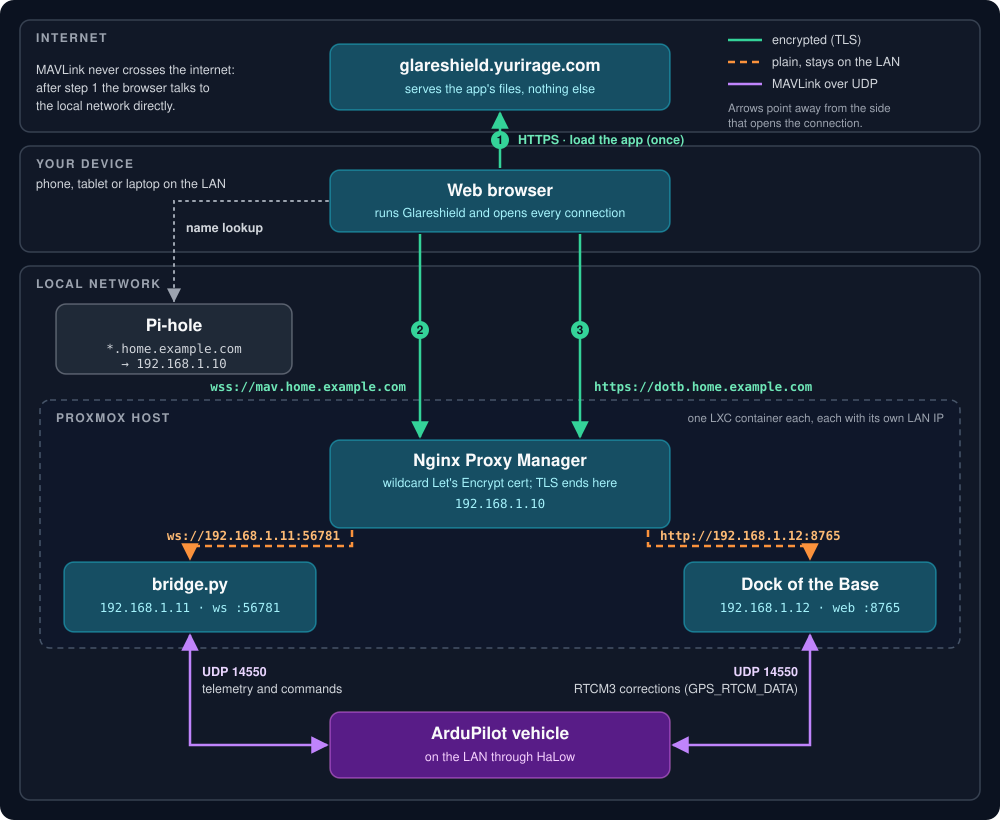

# Reverse Proxy Setup (Own Domain, Trusted Certificates)

This guide puts the telemetry bridge and the HUD's camera feed behind a reverse proxy on your local network, so every browser on the LAN can connect to them with a real, trusted certificate. No certificate warnings, no per-device trust steps, and no browser flags.

It describes one working setup:
- **Nginx Proxy Manager** (NPM) holds a Let's Encrypt wildcard certificate for a domain you own.
- **Pi-hole** resolves the bridge's hostname to the proxy, but only inside your network.
- **bridge.py**, **Dock of the Base** and **go2rtc** (for the HUD video) each run in their own LXC container on a Proxmox host.
- The **vehicle** and its **camera** are on the LAN through HaLow networking.

The same pattern works with other proxies (Caddy, Traefik, plain nginx), other local DNS servers, and Docker instead of LXC. Only the screens differ.

### What is Dock of the Base?

[Dock of the Base](https://github.com/yuri-rage/dock-of-the-base) is a companion project: an RTK base station for u-blox ZED-F9 and ZED-X20 GNSS receivers, run in Docker with a web UI for setup and monitoring. It:
- configures the receiver as a base (survey-in, or a fixed position you enter);
- sends RTCM3 corrections to rovers, directly over MAVLink (`GPS_RTCM_DATA` on UDP 14550, the path shown here), through its own NTRIP caster or TCP repeater, or out to external NTRIP services;
- logs raw observations for post-processing (PPK), with RINEX conversion.

It runs independently of Glareshield; the two only share the vehicle's MAVLink link. It's optional here. Without an RTK base, leave out its proxy host and DNS record. To get corrections from an online NTRIP caster instead, use Glareshield's RTK widget.

Throughout this guide, `home.example.com` stands in for a subdomain of a domain you own, and `192.168.1.x` for your LAN addresses.

---

## How it fits together



1. **The browser loads Glareshield** from `https://glareshield.yurirage.com`. That site only serves the app's files. It never sees your telemetry.
2. **The app opens `wss://mav.home.example.com`.**
   - Pi-hole answers that name with the proxy's LAN address.
   - The proxy presents the trusted certificate, decrypts the connection, and forwards it as a plain WebSocket to `bridge.py`.
3. **`https://dotb.home.example.com` works the same way** for the [Dock of the Base](#what-is-dock-of-the-base) web UI. Glareshield doesn't talk to Dock of the Base; it's a second site behind the same proxy, opened in its own tab.
4. **The HUD opens `https://cam.home.example.com`** for its video background. The proxy forwards it to go2rtc, which holds the camera's login and serves its stream as MJPEG.
5. **On the vehicle side,** `bridge.py` and Dock of the Base each exchange MAVLink with the vehicle over UDP 14550, and go2rtc pulls the camera's stream. Both devices are on the LAN through HaLow.

The legs from the proxy to the containers, and from the containers to the vehicle and camera, are unencrypted, but they never leave your network.

### Why a proxy?

- **No plain `ws://` or `http://` from an `https://` page.** Glareshield is served over HTTPS, and browsers block an HTTPS page from opening an unencrypted connection to another host (mixed content). That covers the bridge's WebSocket and the HUD's camera stream alike.
- **No self-signed certificates.** Running the bridge with its own self-signed certificate works, but every device must accept that certificate once by hand (see the [connection guide](connection-guide.md#option-1-native-tls--wss-recommended-for-encrypted-connections)). Phones, tablets and new laptops make that tedious.
- **Trusted everywhere.** A certificate from Let's Encrypt for a name you own is trusted by every browser out of the box.
- **Nothing exposed to the internet.** The DNS challenge proves domain ownership through your DNS provider, so you don't open any port on your router.

> [!CAUTION]
> The bridge has no authentication: anything that can reach it can command the vehicle. go2rtc's web UI can show and edit its configuration, camera passwords included, and Dock of the Base stores NTRIP credentials in plain text. Keep the proxy reachable only from your LAN, and do not port-forward 80/443 to it. [Step 7](#7-limit-access-to-your-lan-recommended) adds an access list as a second guard.

---

## What you need

- **A domain you own,** with DNS hosted by a provider that NPM supports for DNS challenges (Cloudflare, Route 53, DigitalOcean, and many others). A subdomain such as `home.example.com` keeps local names apart from anything public.
- **Nginx Proxy Manager**, Pi-hole (or another local DNS server your devices use), and a machine for `bridge.py`.
- **A vehicle that sends MAVLink over UDP** to the machines that need it (here, a flight controller on the LAN through HaLow).
- For the HUD video: **a network camera** and **[go2rtc](https://github.com/AlexxIT/go2rtc)**.
- Optional, for RTK corrections: **[Dock of the Base](https://github.com/yuri-rage/dock-of-the-base)** and a u-blox ZED-F9 or ZED-X20 receiver.

The example addresses used below:

| Service | Address | Listens on |
|---|---|---|
| Nginx Proxy Manager | `192.168.1.10` | 80, 443 (and 81 for its admin UI) |
| bridge.py | `192.168.1.11` | WebSocket `56781`, MAVLink UDP `14550` |
| Dock of the Base | `192.168.1.12` | web UI `8765`, MAVLink UDP `14550` |
| go2rtc | `192.168.1.13` | API and streams `1984` |
| Vehicle | on the LAN via HaLow | MAVLink UDP |
| Camera | `192.168.1.20`, on the LAN via HaLow | HTTP `80`, RTSP `554` |

Each service has its own IP address because each runs in its own LXC container. That is also why `bridge.py` and Dock of the Base can both use UDP 14550. Both bind `0.0.0.0:<port>`, so on one shared host only one of them could have that port (see [Sharing one host](#sharing-one-host-docker-instead-of-lxc)).

---

## 1. Run the bridge without TLS

The proxy handles encryption, so the bridge serves plain `ws://` on the LAN.

**Docker** (the image's own entrypoint): in `docker-compose.yml`, set:

```yaml
environment:
  - MODE=udp
  - TARGET=0.0.0.0:14550
  - AUTO_TLS=false
```

**Python:**

```bash
python3 bridge/bridge.py --host 0.0.0.0 --port 56781 --udp 0.0.0.0:14550
```

The bridge must listen on `0.0.0.0` (or its LAN address), not `127.0.0.1`, because the proxy reaches it from another container.

You don't need to add an allowed origin. The proxy passes the browser's `Origin: https://glareshield.yurirage.com` header through unchanged, and the bridge allows that origin by default. If you host Glareshield yourself on another domain, add `--allow-origin "https://your-gcs.example.com"` (Docker: `ALLOW_ORIGINS=`).

## 2. Point the vehicle at the containers

The vehicle must send MAVLink to each container that needs it:
- **`192.168.1.11:14550`** for `bridge.py`.
- **`192.168.1.12:14550`** for Dock of the Base.

How you do that depends on the vehicle's network hardware:
- **Flight controller with networking:** ArduPilot's own networking can run two UDP client ports, one per address (`NET_P1_*`, `NET_P2_*`).
- **Companion computer or radio bridge:** set it to send to both addresses, or to broadcast on the subnet.

Neither service needs the vehicle's address up front. Each learns it from the vehicle's first heartbeat and replies there.

> [!IMPORTANT]
> Only one RTCM source may inject corrections on a MAVLink link. With Dock of the Base sending RTCM3, leave NTRIP and RTK injection off in Glareshield's RTK widget. Two injectors interleave their `GPS_RTCM_DATA` fragments and corrupt each other.

## 3. Serve the camera through go2rtc

The HUD reads the camera as an MJPEG stream. go2rtc stands between the camera and the proxy for three reasons:
- **It logs in to the camera,** so no browser needs the camera's password. Browsers also refuse credentials embedded in an image or fetch URL.
- **It allows cross-origin reads,** which the camera itself doesn't. With CORS allowed, the HUD reads the stream frame by frame, notices a frozen feed within seconds and reconnects. Without it, the HUD falls back to a plain image that can sit frozen on the last frame.
- **One camera connection serves every viewer.** Several browsers or HUDs don't each open their own stream to the camera over HaLow.

A minimal `go2rtc.yaml`:

```yaml
api:
  listen: ":1984"
  origin: "*"   # lets the HUD read the stream with fetch() (CORS)

streams:
  hud: http://<user>:<password>@192.168.1.20/cgi-bin/mjpg/video.cgi?channel=1&subtype=1
```

`subtype=1` is the camera's sub stream: lower resolution, and much lighter on a HaLow link than the main stream. To use the camera's H.264 RTSP stream instead, give go2rtc an `rtsp://` source and let it convert to MJPEG with FFmpeg. That costs CPU on the go2rtc container. See the go2rtc README for the source formats.

Check it from a machine on the LAN: `http://192.168.1.13:1984/api/stream.mjpeg?src=hud` should play in a browser tab.

## 4. Issue a wildcard certificate with the DNS challenge

In the NPM admin UI (port 81):

1. Go to **SSL Certificates → Add SSL Certificate → Let's Encrypt**.
2. For **Domain Names**, enter `*.home.example.com`. Optionally add `home.example.com` itself.
3. Turn on **Use a DNS Challenge** and pick your DNS provider. Paste an API token into the credentials box. For Cloudflare that's a token with **Zone → DNS → Edit** on the zone:
   ```ini
   dns_cloudflare_api_token = <your token>
   ```
4. Agree to the terms and save. Issuing takes a minute while the challenge record propagates.

NPM renews the certificate on its own. Because validation happens in DNS, the proxy never has to be reachable from the internet.

## 5. Add the proxy hosts

Under **Hosts → Proxy Hosts → Add Proxy Host**, add one host for each service:

| Setting | Bridge | Dock of the Base | Camera (go2rtc) |
|---|---|---|---|
| Domain Names | `mav.home.example.com` | `dotb.home.example.com` | `cam.home.example.com` |
| Scheme | `http` | `http` | `http` |
| Forward Hostname / IP | `192.168.1.11` | `192.168.1.12` | `192.168.1.13` |
| Forward Port | `56781` | `8765` | `1984` |
| **Websockets Support** | **On** (required) | Off (the UI is plain HTTP) | On (go2rtc's WebRTC and MSE players use it; MJPEG doesn't need it) |
| SSL tab → SSL Certificate | the `*.home.example.com` certificate | same | same |
| SSL tab → Force SSL | On | On | On |

Set the scheme to `http` even though browsers connect over HTTPS: it describes the proxy's connection to the container, which is plain. If the bridge still has TLS on (`AUTO_TLS=true` or `--ssl-cert`), turn it off as in step 1. Otherwise the proxy speaks plain HTTP to a TLS port and the WebSocket handshake fails.

**Keep idle WebSockets open.** nginx closes a proxied connection after 60 s without data from the upstream. A bridge with no vehicle behind it can be quiet that long, which makes Glareshield drop and reconnect every minute. On the bridge host's **Advanced** tab, add:

```nginx
proxy_read_timeout 1h;
proxy_send_timeout 1h;
```

**Stream the video unbuffered.** By default nginx buffers the response from go2rtc, so MJPEG frames reach the browser late and in bursts. On the camera host's **Advanced** tab, add:

```nginx
proxy_buffering off;
proxy_read_timeout 1h;
```

go2rtc already sends the CORS header (`origin: "*"` in step 3), so the proxy doesn't need to add one. If it did, browsers would see the header twice and reject the response.

## 6. Resolve the names locally with Pi-hole

Both names should resolve to the proxy, not to the containers. The proxy decides where each request goes by its hostname.

- **Pi-hole v6:** **Settings → Local DNS Records**.
- **Pi-hole v5:** **Local DNS → DNS Records**.

Add:

| Domain | IP |
|---|---|
| `mav.home.example.com` | `192.168.1.10` |
| `dotb.home.example.com` | `192.168.1.10` |
| `cam.home.example.com` | `192.168.1.10` |

To cover every name under the subdomain at once, add a wildcard instead. On Pi-hole v6, go to **Settings → All settings → Miscellaneous → `misc.dnsmasq_lines`**, enable the expert settings, and add:

```text
address=/home.example.com/192.168.1.10
```

Devices only use these records if they use Pi-hole for DNS. That usually means handing out Pi-hole's address through your router's DHCP settings. Check from a client:

```bash
nslookup mav.home.example.com
# should answer 192.168.1.10
```

## 7. Limit access to your LAN (recommended)

The names only resolve inside your network, but an access list keeps every service private even if a name leaks or a port is forwarded by mistake. Each one has a reason to stay off the internet:
- the bridge can command the vehicle;
- go2rtc's UI shows its configuration, camera password included;
- Dock of the Base stores NTRIP credentials in plain text.

1. Go to **Access Lists → Add Access List** and name it `LAN only`.
2. On the **Access** tab, add an **allow** rule for your subnet, `192.168.1.0/24`. NPM refuses every address the list doesn't allow. Leave Authorization empty: browsers can't send Basic Auth credentials on a WebSocket handshake.
3. Edit the `mav`, `cam` and `dotb` proxy hosts and set **Access List** to `LAN only` on each.

## 8. Connect

1. Open [https://glareshield.yurirage.com](https://glareshield.yurirage.com) on any device on the LAN.
2. Open **Link Settings** (gear icon) and connect to:
   ```text
   wss://mav.home.example.com
   ```
   Leave off the port: the proxy listens on 443.
3. Chrome and Edge may ask *"Allow Glareshield to connect to devices on your local network?"* the first time, because a public site is reaching a private address. Click **Allow**.

For the HUD video:
1. Open the HUD's settings (the sliders icon in its header) to **HUD & Video Settings → Video Background Feed** and turn it on.
2. Set **Stream URL** to:
   ```text
   https://cam.home.example.com/api/stream.mjpeg?src=hud
   ```
3. Set **Format** to **MJPEG Stream (HTTP)**.

The CAM badge on the HUD shows the feed's state; click it to reconnect.

To open Dock of the Base, browse to `https://dotb.home.example.com`.

---

## Troubleshooting

| Symptom | Likely cause | Fix |
|---|---|---|
| Connection fails at once; the name doesn't resolve | The device isn't using Pi-hole, or uses its own encrypted DNS: Chrome **Secure DNS**, Android **Private DNS**, iCloud **Private Relay**, or a VPN | Point the device's DNS at Pi-hole, or turn the private DNS feature off for this network |
| Certificate error in the browser | The proxy host is missing the wildcard certificate, or the name isn't covered by it (`*.home.example.com` doesn't cover `a.b.home.example.com`) | Select the certificate on the proxy host's SSL tab; use a name one level below the wildcard |
| `502 Bad Gateway`, or the WebSocket closes during the handshake | The proxy can't reach the bridge, or **Websockets Support** is off, or the scheme doesn't match the bridge (TLS on the bridge, `http` on the proxy) | Check the bridge listens on `0.0.0.0:56781`; turn on Websockets Support; run the bridge without TLS |
| Glareshield reconnects about once a minute while idle | nginx's 60 s read timeout | Add the `proxy_read_timeout` lines from step 5 |
| Bridge log: `Refused WebSocket connection from Origin` | Glareshield is served from a domain the bridge doesn't allow | Start the bridge with `--allow-origin "https://<that domain>"` |
| Connected, but no telemetry (0 pkts/s) | The vehicle isn't sending to the bridge's address, or a firewall on the container drops UDP 14550 | Check the vehicle's UDP output targets (step 2); allow 14550/udp on the container |
| HUD settings say *"This camera does not allow CORS"* | The CORS header is missing: go2rtc's `origin` isn't set, or the URL points at the camera directly instead of go2rtc | Set `api: origin: "*"` in `go2rtc.yaml` and restart go2rtc; use the `cam.home.example.com/api/stream.mjpeg` URL |
| HUD video lags or arrives in bursts | nginx is buffering the stream | Add `proxy_buffering off;` to the camera host (step 5) |
| HUD video is blank and the CAM badge shows an error | go2rtc can't reach or log in to the camera | Open `http://192.168.1.13:1984` and check the `hud` stream; check the camera's address and credentials in `go2rtc.yaml` |
| RTK fix drops in and out, corrections look corrupt | Two RTCM injectors on one link | Disable NTRIP/RTK injection in Glareshield while Dock of the Base supplies corrections |

---

## Variations

### Sharing one host (Docker instead of LXC)

On a single Docker host with host networking, `bridge.py` and Dock of the Base can't both bind UDP 14550. Give one of them another port (for example, run the bridge with `--udp 0.0.0.0:14551`) and point the vehicle's second output there. The proxy steps don't change; use the host's address with each service's port.

### Other proxies

The requirements carry over to any reverse proxy:
- terminate TLS with a trusted certificate;
- forward WebSocket upgrades (`Upgrade` and `Connection` headers) to the bridge's plain `ws://` port;
- keep the read timeout well above a minute;
- pass the `Origin` header through;
- turn response buffering off for the camera stream.

Caddy does all of this by default; see the [connection guide](connection-guide.md#option-4-local-reverse-proxy--cloudflare-tunnel--caddy).

### Reaching the bridge from outside the LAN

Don't open the proxy to the internet. Use a VPN such as Tailscale or WireGuard, and point the VPN's DNS at Pi-hole so the same names resolve. The bridge has no authentication of its own; the [connection guide](connection-guide.md#option-4-local-reverse-proxy--cloudflare-tunnel--caddy) explains the risks.
